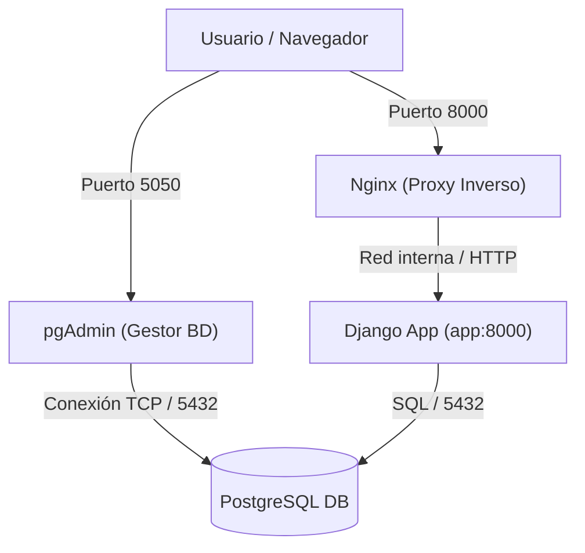

# AE4 — Aplicación Web con Base de Datos en Contenedores (DPL - UT4)

Memoria técnica y guía de despliegue para una arquitectura multicapa contenerizada utilizando Docker Compose, desarrollada para el módulo de Despliegue de Aplicaciones Web (DPL).

---

## 📋 1. Resumen y Objetivos del Proyecto

El objetivo de esta práctica es diseñar, implementar y desplegar una aplicación web multicapa basada en microservicios contenerizados. A diferencia de los monolitos tradicionales, este sistema aísla cada componente (servidor web, lógica de aplicación, base de datos y panel de gestión) en contenedores independientes que se comunican de forma segura a través de una red interna privada.

---

## 🏗️ 2. Arquitectura del Sistema y Decisiones de Diseño

El sistema se compone de **4 servicios** orquestados mediante Docker Compose:

1. **Nginx (`dpl-nginx`)**: 
   * **Rol:** Proxy inverso y puerta de enlace pública.
   * **Por qué:** Evita exponer directamente el servidor de aplicaciones al exterior. Recibe el tráfico HTTP de los usuarios en el puerto `8000` y lo redirige de forma interna al contenedor de Django.
2. **Django / Gunicorn (`dpl-app-django`)**: 
   * **Rol:** Servidor de aplicaciones web y API REST (`servicio app`).
   * **Por qué:** Procesa la lógica de negocio utilizando Gunicorn como servidor WSGI de producción, conectado de forma interna a la base de datos.
3. **PostgreSQL (`dpl-db`)**: 
   * **Rol:** Sistema de gestión de bases de datos relacionales.
   * **Por qué:** Almacena de forma persistente los datos de los lugares turísticos gracias al uso de volúmenes de Docker, evitando la pérdida de información ante reinicios.
4. **pgAdmin (`dpl-pgadmin`)**: 
   * **Rol:** Interfaz web de administración de la base de datos (expuesta en el puerto `5050`).
   * **Por qué:** Facilita la gestión visual de PostgreSQL mediante un entorno gráfico basado en web.

### Diagrama de Arquitectura



## 📁 3. Distribución de los Componentes
AE4/
├── app/                  
│   ├── Dockerfile        # Receta para construir la imagen de Django con Python 3.12
│   └── requirements.txt  # Dependencias Python del proyecto
├── db/                   
│   └── init.sql          # Script SQL ejecutado automáticamente al arrancar Postgres (crea tablas y los 11 registros iniciales)
├── nginx/                
│   └── default.conf      # Configuración de Nginx como proxy inverso hacia http://app:8000
├── compose.yml           # Archivo maestro de orquestación (redes, volúmenes, variables de entorno y healthchecks)
├── deploy.sh             # Script de automatización integral (construcción, despliegue y validación)
├── comprobaciones.txt    # Fichero de evidencias con salidas reales del sistema
└── README.md             # Esta memoria técnica

## ⚙️ 4. Explicación de los Componentes Clave

### A. Orquestación y Salud (`compose.yml`)
- Se definen variables de entorno centralizadas (usuario `alumno`, base de datos `travelroad`).
- Se implementan **healthchecks** (controles de salud) tanto en la base de datos como en la app. Esto permite utilizar la directiva `condition: service_healthy` en el `depends_on`, garantizando que Django no arranque hasta que PostgreSQL esté completamente listo para aceptar conexiones, evitando los típicos errores de sincronización al iniciar.

### B. Inicialización de Datos (`db/init.sql`)
- Al levantar el contenedor de PostgreSQL por primera vez, lee este script y puebla automáticamente la base de datos con **11 registros iniciales** (lugares turísticos), garantizando que la aplicación tenga datos desde el primer segundo sin intervención manual.

### C. Proxy Inverso (`nginx/default.conf`)
- Configurado para redirigir todo el tráfico raíz (`/`) hacia el backend de Gunicorn (`http://app:8000`), inyectando cabeceras de red (`X-Real-IP`, `Host`) para preservar la identidad de las peticiones del cliente.

---

## 🚀 5. Guía de Despliegue desde Cero (Para Futuras Referencias)

Si necesitas desplegar este entorno en una máquina limpia en el futuro, sigue estos pasos exactos desde tu terminal:

### Paso 1: Clonar el repositorio
Descarga el proyecto en tu equipo mediante SSH:
```bash
git clone git@github.com:xerachrrm/AE4-Aplicaciones-web.git
cd AE4-Aplicaciones-web
```

### Paso 2: Ejecutar el script de despliegue automatizado
El proyecto cuenta con el script `deploy.sh` que automatiza la compilación y el arranque seguro. Dale permisos de ejecución y lánzalo:
```bash
chmod +x deploy.sh
./deploy.sh
```

---

## 🔍 6. Verificación y Pruebas del Sistema

Una vez desplegado, puedes comprobar el estado del sistema ejecutando estos comandos de verificación:

1. **Verificar el estado de los contenedores** (todos los servicios deben mostrarse en activo y los críticos en estado `healthy`):
   ```bash
   docker compose ps
   ```

2. **Comprobar la salud de la aplicación**:
   ```bash
   curl -sf http://localhost:8000/healthz
   ```

3. **Consultar la API REST de lugares** (debe devolver el JSON con los 11 registros):
   ```bash
   curl -sf http://localhost:8000/api/lugares
   ```

4. **Verificar directamente los registros en la base de datos PostgreSQL**:
   ```bash
   docker compose exec -T db psql -U alumno -d travelroad -c "SELECT count(*) FROM places;"
   ```

---

## 🛠️ 7. Comandos Útiles de Mantenimiento

- **Para apagar el sistema de forma segura:**
  ```bash
  docker compose down
  ```

- **Para destruir el entorno por completo y borrar los volúmenes** (reinicio limpio desde cero):
  ```bash
  docker compose down -v
  ```

- **Para ver los logs de los contenedores en tiempo real** si surge algún error:
  ```bash
  docker compose logs -f
