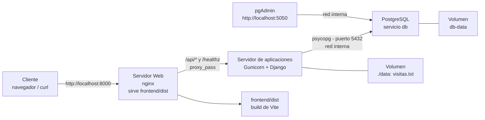

# Material de la UT4 — aplicación Web contenerizada (Django + nginx + Vite + PostgreSQL)

Código real, reproducible y verificable para las prácticas y la **AE4** de la UT4: la aplicación de ejemplo del curso, compuesta por un **servidor de aplicaciones Django (Gunicorn)**, un **servidor Web nginx** que sirve el **build de Vite** (Web Components) y hace de proxy inverso, una **capa de datos PostgreSQL** y **pgAdmin** para administrarla. Todo se despliega con **Docker Compose**.

El alumno **solo despliega** este material: no escribe la aplicación. Lo copia a su directorio de trabajo, lo adapta a su entrega y lo documenta.

## Qué contiene

```text
material/
├── compose.yml              # despliegue completo: db + pgadmin + django + nginx
├── check.sh                 # comprobación objetiva del despliegue (exit 0/1)
├── check_api.py             # comprobación con python-requests (vínculo DWES)
├── .dockerignore            # excluye lo innecesario del contexto de build
├── Dockerfile               # Dockerfile de referencia de la app (contexto raíz)
├── db/                      # CAPA DE DATOS
│   ├── init.sql             # crea y carga la tabla places (primera inicialización)
│   └── places.csv           # datos de ejemplo (11 lugares) para cargar con COPY
├── app/                     # SERVIDOR DE APLICACIONES: proyecto Django
│   ├── Dockerfile           # imagen python:3.12-slim + Gunicorn + psycopg + no root
│   ├── manage.py            # utilidad de administración de Django
│   ├── requirements.txt     # Django, Gunicorn, psycopg y ldap3 (versiones orientativas)
│   ├── config/              # proyecto Django: settings, urls, wsgi
│   └── api/                 # aplicación: /, /healthz, /api/mensaje, /api/visitas, /api/lugares, /api/login
├── frontend/                # FRONTEND: proyecto Vite (Web Components)
│   ├── package.json         # Vite (versión orientativa)
│   ├── index.html           # página en desarrollo
│   ├── src/                 # componentes con shadow DOM (fetch a la API)
│   └── dist/                # BUILD PRECOMPILADO (lo que sirve nginx)
├── nginx/                   # SERVIDOR WEB: nginx sobre Ubuntu 24.04
│   ├── Dockerfile.nginx     # ubuntu:24.04 + apt install nginx (foreground)
│   └── default.conf         # estáticos + try_files + proxy_pass a django
└── spa/                     # SPAs de ejemplo: React, Vue, Svelte
    ├── react/
    ├── vue/
    └── svelte/              # cada una con src/, dist/ y README de despliegue
```

## Arquitectura



El cliente solo ve el puerto **8000** de nginx y el **5050** de pgAdmin; el puerto 8000 de Django y el 5432 de PostgreSQL son internos (red de Compose) y no se publican. La capa de datos se explica en [Base de datos para el despliegue](../teoria/base-datos.md) y el patrón nginx → Gunicorn en [Servidores de aplicaciones](../teoria/servidores-aplicaciones.md).

## Cómo usarlo

El material se copia a tu directorio de trabajo (no se ejecuta desde el repositorio del curso):

```bash
mkdir -p ~/dpl/ae4
cp -r docs/ut03/material/. ~/dpl/ae4/
cd ~/dpl/ae4
docker compose up -d          # construye y arranca (db + pgadmin + django + nginx)
docker compose ps             # estado: PostgreSQL (healthy), django (healthy), nginx y pgadmin
curl http://localhost:8000/   # página del frontend (build de Vite)
curl http://localhost:8000/api/lugares   # datos de PostgreSQL a través del proxy
./check.sh                    # comprobación automática (0 = todo OK)
```

Credenciales de laboratorio (nunca reales): usuario `alumno` y contraseña `CAMBIAR_ESTO`, con valores por defecto en `compose.yml`. Para usar otras, expórtalas antes de arrancar y no las escribas en el repositorio:

```bash
export DB_PASSWORD="..."          # PostgreSQL
export PGADMIN_PASSWORD="..."     # interfaz de pgAdmin
docker compose up -d
```

Limpieza: `docker compose down` (conserva el bind mount `./data` y los volúmenes con nombre `db-data` y `pgadmin-data`); `docker compose down -v` borra también los volúmenes con nombre (pierdes los datos de PostgreSQL). Publicación de puertos, volúmenes, variables de entorno y redes: teoría en [Docker](../teoria/docker.md).

## La capa de datos

- El servicio **`db`** usa la imagen oficial `postgres:16-alpine` (orientativa) y no publica el 5432: la app se conecta por la red interna con `DB_HOST: db`.
- **`db/init.sql`** crea la tabla `places` y carga 11 filas de ejemplo. PostgreSQL lo ejecuta **solo la primera vez** que se inicializa el volumen `db-data`; para repetirlo: `docker compose down -v && docker compose up -d`.
- **`db/places.csv`** contiene los mismos datos en CSV para practicar la carga con `COPY`/`\copy` (ver [Práctica guiada 11](../practicas/guiada-11-postgresql-pgadmin.md)).
- La aplicación lee la configuración de `DB_HOST`, `DB_NAME`, `DB_USER`, `DB_PASSWORD` y `DB_PORT`; si no existe `DB_HOST`, funciona **sin base de datos** y `/api/lugares` responde 503 (así el material sigue sirviendo para las primeras prácticas).
- **pgAdmin** se publica en `http://localhost:5050` (correo y contraseña por variables de entorno). Puede tardar un par de minutos en estar listo la primera vez; el registro del servidor dentro de pgAdmin se explica en la práctica guiada.

## Autenticación con directorio LDAP

La aplicación integra la autenticación contra un **servicio de directorio** (UT5) mediante el endpoint **`/api/login`**, que hace un *bind* LDAP con el usuario y la contraseña recibidos:

```bash
# Autenticación correcta: 200 con el perfil del usuario del directorio
curl -s -X POST -d "usuario=alumno&password=CAMBIAR_ESTO" \
     http://localhost:8000/api/login
# Autenticación incorrecta: 401
curl -s -o /dev/null -w '%{http_code}\n' -X POST -d "usuario=alumno&password=incorrecta" \
     http://localhost:8000/api/login
```

Se activa definiendo `LDAP_HOST` (URL del directorio, p. ej. `ldap://IP_DPL_LAB`); el resto de variables (`LDAP_BASE_DN`, `LDAP_USER_FILTER`) tienen valores por defecto. Si `LDAP_HOST` está vacía, el endpoint responde 503 (la app funciona sin directorio). El servicio de directorio (`slapd`) y su configuración se ven en [Servicio de directorio](../../ut05/teoria/servicio-directorio.md) y en la [práctica guiada 16](../../ut05/practicas/guiada-16-directorio.md).

!!! warning "Estado de verificación del endpoint `/api/login`"
    El endpoint se ha **revisado por sintaxis, no probado en ejecución** (el `ldap3` y el flujo de bind siguen la [teoría del servicio de directorio](../../ut05/teoria/servicio-directorio.md), verificada por componentes). Antes de evaluarlo, pruébalo con un directorio `slapd` real siguiendo la [práctica guiada 16](../../ut05/practicas/guiada-16-directorio.md).

## Relación con las prácticas y la AE4

- **Práctica guiada 10** trabaja los fundamentos de Docker (contenedores, puertos, volúmenes y redes): [guiada-10](../practicas/guiada-10-docker-basico.md).
- **Práctica guiada 12** despliega paso a paso este material completo con Compose: [guiada-12](../practicas/guiada-12-despliegue-compose.md).
- **Práctica guiada 11** levanta PostgreSQL y pgAdmin, carga los datos y conecta la aplicación: [guiada-11](../practicas/guiada-11-postgresql-pgadmin.md).
- **Práctica autónoma 04** te pide desplegarlo tú solo: [autonoma-04](../practicas/autonoma-04-despliegue.md).
- La **AE4** exige entregar un `ae4/` con un árbol adaptado (`compose.yml`, `db/init.sql`, `app/`, `nginx/default.conf`, `deploy.sh`, README.md, comprobaciones.txt): [tarea evaluable](../tarea-evaluable.md). Este código es la base de referencia; el entregable es tuyo (cópialo, adáptalo y documéntalo).

## Decisiones de diseño

- **Puerto 8000** en toda la unidad: es el que publica nginx en el anfitrión (`8000:80`). El docente comprueba `curl http://localhost:8000`. Si lo cambias, documéntalo. pgAdmin usa el **5050**.
- **Cuatro servicios** en `compose.yml`: `db` (PostgreSQL, puerto interno 5432), `pgadmin` (interfaz web), `django` (Gunicorn + Django, puerto interno 8000 sin publicar) y `nginx` (puerta de entrada: estáticos + proxy inverso). El patrón de cooperación se explica en [Servidores de aplicaciones](../teoria/servidores-aplicaciones.md) y [Despliegue](../teoria/despliegue.md).
- **Persistencia:** el contador de visitas se escribe en `/data/visitas.txt` (carpeta `APP_DATA_DIR`), montado desde `./data` (bind mount); los datos de PostgreSQL viven en el volumen con nombre `db-data` y la configuración de pgAdmin en `pgadmin-data`.
- **Configuración por variables de entorno:** `APP_MENSAJE`, `APP_DATA_DIR`, `DB_*`, `LDAP_*` y `PGADMIN_*`; sin credenciales reales (clave SECRET_KEY de laboratorio en `settings.py`, no usable en producción).
- **Usuario no root** (`appuser`, uid 1000) dentro de la imagen Django; en Linux, si la app no puede escribir en `./data`, ejecuta `sudo chown -R 1000:1000 data`.
- **Healthchecks** en los tres servicios de larga vida: `django` sobre `/healthz`, `db` con `pg_isready`, `pgadmin` sobre `/misc/ping`; `nginx` espera a `django` sano y `django`/`pgadmin` esperan a `db` sano (`depends_on: condition: service_healthy`).
- **nginx sobre Ubuntu 24.04 + apt**, coherente con el resto del curso (sin systemd en contenedores: `nginx -g 'daemon off;'` en foreground).
- **Versiones orientativas:** `python:3.12-slim`, `Django==5.1.6`, `gunicorn==23.0.0`, `psycopg[binary]==3.2.4`, `ldap3==2.9.1`, `postgres:16-alpine`, `dpage/pgadmin4:9.17`, `ubuntu:24.04` y `vite ^6` (cualquier estable reciente sirve; los sufijos `-alpine`/`-slim` reducen el tamaño).

## Estado de verificación

**Base nginx + Django verificada en ejecución** por el agente verificador del curso (2026-09-08, Docker 29.4.3 + Compose v5.1.3, despliegue desde copia temporal):

- `docker compose up -d --build` construía las imágenes `dpl-app-django` y `dpl-app-nginx` y arrancaba ambos servicios sin errores; `docker compose ps` mostraba `dpl-django` en `Up (healthy)` y `dpl-nginx` en `Up`.
- `curl http://localhost:8000/` → 200 (build de Vite servido por nginx, incluye `dpl-visitas`); `curl -sf http://localhost:8000/healthz` → 200; `curl -sf http://localhost:8000/api/mensaje` → JSON `{mensaje, hostname, fecha}`; `curl -sf http://localhost:8000/api/visitas` → el contador incrementa (1 → 2 → 3). Una ruta interna (`/ruta/interna/spa`) devolvía 200 con `index.html` (patrón SPA `try_files`).
- **Persistencia:** tras `docker compose restart django` el contador continuaba (no se reiniciaba): el valor se conserva en `./data/visitas.txt` (bind mount).
- El `check.sh` de la versión de dos servicios terminaba con **exit 0**; `docker compose exec nginx nginx -t` → `syntax is ok` (nginx 1.24.0, Ubuntu 24.04); `docker compose down` liberaba los contenedores y conservaba `./data`.

**Ampliación a la capa de datos (2026-09-12): verificada en ejecución** por el agente verificador del curso (Docker 29.7.2 + Compose v5.5.1, macOS; copia temporal del material):

- `docker compose up -d --build` construyó `dpl-app-django` y `dpl-app-nginx` y arrancó los cuatro servicios: `dpl-db` (healthy, PostgreSQL 16.15), `dpl-django` (healthy), `dpl-pgadmin` (healthy, pgAdmin 9.17) y `dpl-nginx` (nginx 1.24.0 sobre Ubuntu 24.04).
- `./check.sh` terminó con **exit 0**: PostgreSQL responde, `/` sirve el build de Vite con `dpl-visitas`, `/healthz` responde 200, `/api/mensaje` devuelve JSON, `/api/lugares` devuelve los **11 lugares** de `db/init.sql` tras pasar por el proxy inverso, el contador incrementa y pgAdmin responde `/misc/ping`.
- **Persistencia:** tras `docker compose restart django` el contador continuó (el valor se conserva en `./data/visitas.txt`; `restart count` 0).
- `docker compose exec nginx nginx -t` → `syntax is ok`; pgAdmin responde en `/login` (200) y `/misc/ping` (`PING`); el puerto 8000 de Django no se publica.
- **Errata corregida** en `check.sh` (antigua línea 120): al usar `PUERTO=8080 ./check.sh`, el paso 9 llamaba a `check_api.py` sin propagar el puerto y comprobaba el 8000 por defecto; ahora se pasa `DPL_BASE_URL="${BASE}"` y `DPL_SIN_BD` según exista el servicio `db`.
- El `Dockerfile` de referencia de la raíz (contexto raíz) también se construyó con éxito (`docker build -f Dockerfile .`).
- La verificación usó los puertos **18000/15050** mediante un `compose.override.yml` **solo en la copia temporal**, porque el contenedor persistente `dpl-lab` del curso ocupaba el 8000/5050 en la máquina del verificador; los puertos publicados por el material (8000 y 5050) no se cambiaron.

Autoría de la verificación: imagen oficial de Ubuntu — https://hub.docker.com/_/ubuntu

- `frontend/dist/` (build manual): **verificado en ejecución** servido por nginx (página 200 + assets 200). No se ha ejecutado `npm run build` del `frontend/`; el despliegue del curso no necesita recompilar.
- `spa/react`: **`npm run build` verificado** en contenedor `node:22` (vite 6.4.3, 26 módulos, exit 0) y el `dist/` regenerado servido con nginx + `try_files` (200 en `/`, assets y rutas internas). Autoría: imagen oficial de Node — https://hub.docker.com/_/node
- `spa/vue` y `spa/svelte`: `dist/` (build manual) **verificado en ejecución** servido por `python3 -m http.server` en contenedor (página 200 + assets 200); `npm run build` de estos dos **no ejecutado**.
